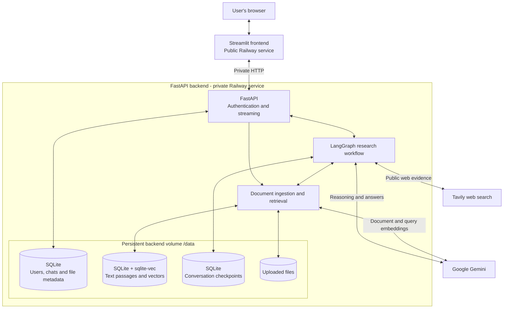

# Market Research Intelligence Agent

**Turn market reports and web research into clear, source-backed business insights.**

An AI-powered research application for exploring markets, comparing competitors,
and evaluating business opportunities through a conversation.

## Live Application

**[Open the Market Research Intelligence Agent](https://market-research-intelligence-agent.up.railway.app/)**

The application is live on Railway. Sign in to upload reports, use web research,
and save research conversations. Guest chat supports general questions and recent
follow-up context.

## Overview & Problem

Market research involves more than finding information. Analysts must read lengthy
reports, compare sources, check dates, and turn scattered findings into a useful
business assessment. Repeating that work for each new question takes time.

Market Research Intelligence Agent brings document analysis and web research into
one conversation. Ask about a market, upload supporting reports, and explore
competitors, growth drivers, risks, or possible services to offer.

The system retrieves relevant evidence and helps organize it into the format the
question needs, from a short explanation to a comparison table or preliminary
assessment. Source references help users check the findings and pursue gaps.

## Core Features

- **Document analysis** extracts searchable text from PDF, DOCX, and TXT files
  attached to a research chat.
- **Adaptive retrieval** lets the research agent choose document search, web
  search, or both from the sources enabled for the conversation.
- **Automatic web research** uses Tavily when the agent needs current information
  or additional evidence and the user has enabled web search.
- **Competitor analysis** supports comparisons of companies, offerings, pricing,
  and positioning using the evidence available.
- **Market trends and business opportunities** can be explored through questions
  about demand, adoption, barriers, potential services, and market-entry risks.
- **Evidence-grounded answers and citations** connect retrieved passages to report
  filenames, PDF page numbers where available, and web source links. The agent is
  instructed to distinguish reported facts, forecasts, and business inferences.
- **Conversational memory** preserves signed-in research threads so users can
  revisit findings and ask follow-up questions.

File search becomes available automatically when files have been added successfully
to the current chat. **Search the web** is a user-controlled option, enabled by
default. The agent chooses how to use the available sources within those settings.

## How It Works

1. **Define the research question** by describing the market, business decision,
   time period, and information you need.
2. **Add supporting material** by signing in and attaching reports to a chat.
   The application prepares their text for searching.
3. **Set the source scope** using the web-search option. For a report-only
   assessment, turn it off and specify the report in your question.
4. **Let the agent gather evidence** from relevant document passages and, when
   appropriate and enabled, public web sources.
5. **Review the answer** synthesized by Gemini, with instructions to match your
   request, cite sources, and disclose gaps.
6. **Refine the investigation** with comparisons, challenges to assumptions, or
   more focused questions in the same saved conversation.

## Architecture

Two Railway services separate the public interface from the research backend.
Streamlit communicates with FastAPI over the private network. The backend manages
provider calls and stores application data on its persistent volume.

Uploaded text is split into passages and converted into embeddings, numerical
representations used to find related content. Retrieval filters results by user
and conversation. LangGraph coordinates tool use and saves conversation state in
SQLite checkpoints.

## Technology Stack

| Technology | Role |
|---|---|
| Python | Application and research workflow implementation |
| Streamlit | Browser interface for chat, uploads, and research controls |
| FastAPI & Pydantic | Backend services, request validation, and streamed responses |
| LangGraph | Research orchestration, tool selection, and conversation state |
| LangChain | Model interfaces, document loading, text splitting, and retrieval integration |
| Google Gemini | Answer generation, tool-use decisions, and document/query embeddings |
| Tavily | Web search with source URLs and supporting text |
| SQLite & SQLAlchemy | User accounts, chat metadata, document records, and database access |
| sqlite-vec | Vector similarity search over uploaded document passages |
| Docker & Railway | Separate containerized services and persistent backend storage |
| pytest & Streamlit AppTest | Backend regression tests and frontend interaction checks |

## Engineering Highlights

- **Streaming and responsiveness** deliver answers incrementally. Keep-alive
  events support longer operations, and blocking vector work runs in worker threads.
- **Authentication and data isolation** combine hashed passwords, JWT-based
  access, ownership checks, and user-and-chat filters for document retrieval.
- **Persistent conversations** use LangGraph SQLite checkpoints alongside stored
  chat metadata, vector indexes, and uploaded files on the backend volume.
- **Vector retrieval** uses separate Gemini embedding tasks for documents and
  queries, with source metadata carried into the research context.
- **Upload validation and recovery** check file type, size, and filename safety.
  Documents become visible after indexing succeeds, with cleanup on upload failure.
- **Provider error handling** reports quota limits, timeouts, and interrupted
  responses. A failed web search returns an evidence-unavailable response with any
  surviving retrieved evidence.
- **Regression coverage** includes source routing, access control, document
  lifecycle, interrupted streams, and Streamlit interactions. Offline tests use
  disposable databases and controlled provider responses. Separate checks exercise
  live providers and container persistence.

## Limitations

- **Source quality and freshness** affect every conclusion. Reports may be dated,
  and web results may be incomplete or disagree. Check dates and original sources.
- **Model accuracy** needs human review. Generated interpretations, figures, and
  citations can contain mistakes, especially when evidence is sparse or ambiguous.
- **API quotas and availability** can delay or interrupt research. Large reports
  may take several minutes to index or fail when embedding quotas are exhausted.
- **Document coverage** depends on extractable text. Supported uploads are PDF,
  DOCX, and TXT up to 50 MiB. Image-only scans require text extraction beforehand,
  and complex tables or charts may lose information during parsing.
- **Research coverage** is bounded. Retrieval selects a limited set of passages
  and web results, so important details can be missed. Follow-up questions and
  checks against the full source help address gaps.
- **Source selection** depends on both user settings and model decisions. For a
  strict document-only investigation, disable web search and state the restriction.
- **Deployment capacity** is based on a single backend instance with SQLite-backed
  storage. Higher concurrency and additional backend replicas require validation.

---
